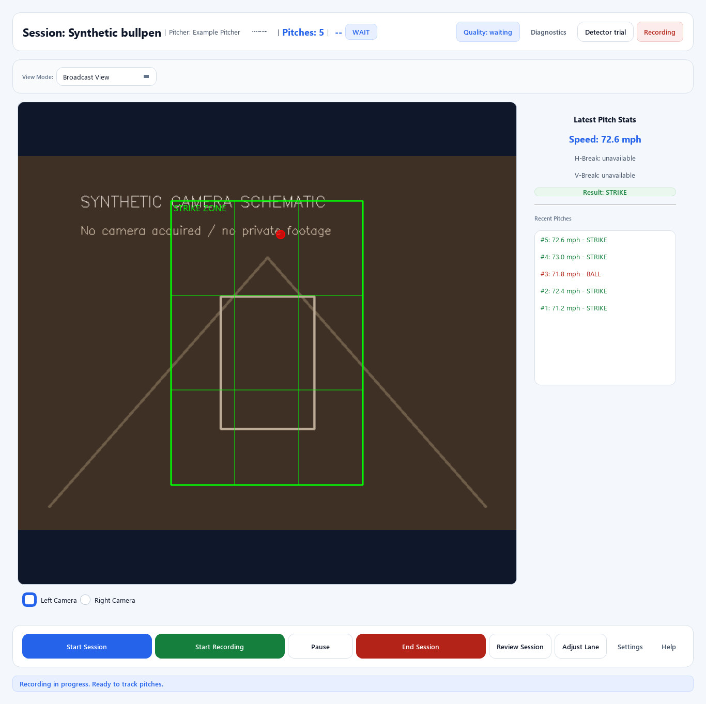
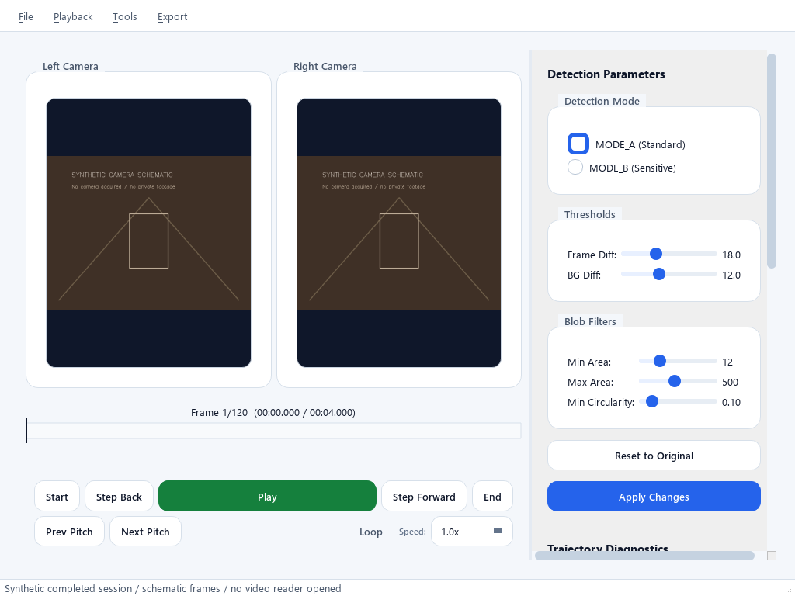

# UX-01: workspace specification and evidence

**Last reviewed:** 2026-10-13
**Package:** UX-01 in the [action plan](../../UX_WORKSPACE_PLAN.md).
**Delivery status:** [Roadmap](../../ROADMAP.md).
**Source baseline:** `71d8231c08ea36e3982ddaf5c3462ad88bb57a6a` plus the
documentation/evidence worktree. No application behavior changes in this package.

## Reviewable artifacts

- [Interactive target workspace](workspace.html): switch pages, example states,
  data availability and viewport sizes. All interactions are local synthetic
  design examples; no domain operation or persistent change occurs.
- [Current UI gallery](baseline/index.html) and [capture manifest](baseline/manifest.json):
  60 real-widget captures, including the three size targets, seven live fixtures,
  all five setup stages, review, players, analytics and recording settings.
- [Target render checks](target/checks.json): prototype viewport/action checks
  and navigation, pause, setup protection and pitch-selection interactions;
  45 target captures cover three sizes, including settings and analytics dialogs.
- [Baseline capture tool](../../../scripts/capture_ux_baseline.py) and
  [prototype rendering tool](../../../scripts/render_ux_prototype.py).

Baseline inputs replace preferences and roster reads with synthetic values,
disable launcher background work and use a display-only Qt pipeline. Setup
writes only disposable fixture configuration under ignored `screenshots/`.
Stages are selected directly without marking prerequisites passed. Review shows
injected pitch-list entries and schematic frames, not a loaded video session.
Fixture state labels do not prove lifecycle correctness.

Installed Segoe UI fonts are explicitly loaded for offscreen capture. An earlier
fontless render was invalid and was replaced; its geometry is not used here.
These pixels and interactions do not establish Windows scaling, screen-reader,
real-camera behavior or physical accuracy.

## Rendered findings and disposition

| Finding | Observed evidence | Action |
|---|---|---|
| Live window exceeds the height target | Idle request 1366x768 renders 1366x1363; its minimum size hint is 1095x1363. At 1024x768 it grows to 1095x1363. | UX-02 must remove hosted-page sizing constraints; UX-04 must make live content shrinkable. |
| Populated live requires additional width | Recording fixture request 1024x768 renders 1225x1363; header contents contribute to the width constraint. | Flexible header plus compact action grouping in UX-02/03. Do not attribute the entire minimum to video alone. |
| Core controls compete with research actions | 13 visible buttons in the live fixture: eight bottom actions, Switch, Diagnostics, Detector trial and two camera radio controls. | UX-03 prioritizes session actions; UX-04 moves research actions to advanced tools. |
| Pitcher Switch is tiny | Captured control rectangle is 60x24; it also has no explicit accessible name. | Replace the local height override and supply a contextual accessible name. |
| Help has no connected action | The capture manifest records zero clicked-signal receivers; source has no connected Help handler. | Wire maintained context help in UX-07. |
| Review prioritizes technical panels | Two video panes are visible; detection controls appear before the pitch list in the scrolling right panel. | UX-05 puts pitch selection/playback/results first. |
| Setup and review whole-window oversizing was not reproduced | Both honor 1366x768, 1024x768 and 800x600 with scrolling; setup navigation remains outside the scroll area. | Preserve completed historical responsive fixes. Scrolled-off controls are not automatically unreachable. |
| Shared visual system already exists | Light surfaces, blue accents, rounded containers and common control styles render consistently. | Reuse it; simplify hierarchy rather than adding a second theme. |

The evidence records requested and actual sizes, device pixel ratio, visible
button rectangles, scroll ranges and signal receiver counts. Geometry records
are diagnostic, not automatic usability scores. Header label lengths and actual
font availability can affect the minimum sizes.

Selected baseline examples:





## Target layouts and action hierarchy

### Persistent workspace

Use a left navigation rail and a status/action header above the active page.
The header displays the active session, pitcher, recording state and one primary
next action; it remains visible when page content scrolls. Historical selection
never replaces active-session identity in that header. Default launch selects
Live without acquiring cameras; `--setup` selects Setup.

At 1366px, use a 168px rail and 24px content padding. At 1024px and 800px,
use a 136px rail and 16px padding. Page content scrolls vertically; essential
session controls do not scroll away. At narrow widths allow a second header
row instead of truncating status. No page imposes a minimum window beyond the
requested size. At 800x600, collapse content columns when needed and keep
secondary details reachable through scrolling.

### Live

- Latest Pitch: velocity/source and strike-zone result at the left; resizable
  video at the right; recent pitches below. Neither pane fixes an 800x600 minimum.
- Session Trends: existing summary charts and a readable table equivalent.
  Preserve outcome denominators, unavailable attempts and provenance.
- Games: existing practice capabilities remain available; unavailable results
  do not become game attempts.
- Advanced tools: capture/tracking diagnostics and detector trials are explicit
  secondary tasks. Setup/rig edits stay in Setup and obey service admission.
- Empty/Ready: explain that nothing is being saved yet. Unavailable/Rejected:
  retain the attempt, show the reason and omit normal result/location markers.

### Sessions and review

Use a completed-session browser at the left, with selected-pitch playback,
metrics and pitch list in the content pane. Show session/pitch identity near
playback. Technical parameters and diagnostics are collapsed advanced tools.
Keep local session opening and explicit export available. An empty browser
explains how to create a recording and links to Live.

Review the just-ended session only after successful finalization. If assets are
missing, provide metadata-only/degraded presentation where supported and explain
which playback or overlay capability is unavailable. Never fabricate a timestamp
mapping or open the active recording as a completed session.

### Players

Show a roster and session-history access. Browsing a roster entry filters
historical content only. Use for Next Pitch is an explicit session command,
admitted at a safe pitch boundary; history and the current pitch retain their
existing attribution. Empty roster offers Add Player. Existing names remain the
identity mechanism for this migration; no incidental player-ID schema migration.

### Setup

Host the existing five guided stages and preserve immediately saved edits,
generation-bound evidence and final publication. Show saved/readiness status and
specific blockers. During runtime capture display view-only guidance with a
Return to Live action. Do not call an edit API that implicitly stops preview as
a consequence of selecting the page.

### Dialogs and analytics

Use dialogs for bounded tasks such as session preparation and settings, with
explicit Cancel and a contextual primary action. Keep normal page navigation
outside dialogs. The prototype's example settings form never persists values.

Session summaries use shared metric cards, chart colors and units, paired with
an accessible data table. Research classification remains explicitly research;
do not add stronger pitch-type or movement claims through a layout change.
The prototype includes a summary dialog and settings dialog to show this treatment.

## Shared component specification

These are target variants within the current token/StyleManager system, not
a new styling framework. Add missing variants to the shared system when their
implementation package begins.

| Component | Required variants/behavior | Defaults |
|---|---|---|
| Workspace navigation | Current page, keyboard focus, available/blocked action | Live / Sessions / Players / Setup; secondary Settings / Help |
| Session status | Idle, Preview, Ready, Recording, Paused, Finalizing, Completed; error overlay | Text plus semantic badge; active identity distinct from selected history |
| Primary action | Normal, focused, pending, disabled with prerequisite | Shared 40px control minimum; 48px prominent session action where space permits |
| Metric | Populated, waiting, unavailable, rejected, estimated/degraded provenance | 56px numeric hero at wide layout, 44px compact; units 16px; tabular figures |
| Location/result | Accepted estimated location, unknown, rejected | Strike/ball use outcome semantics, not operational error styling |
| Surface | Plain, bordered content group, preview, advanced disclosure | Existing light palette; 12px compact content radius, existing 16px larger panels |
| Chart/table | Empty, populated, partial, unavailable comparison | Labels, explicit units/sample counts and text/table equivalent |
| Notice | Information, prerequisite, progress, recoverable error | Concrete affected operation and supported next action; no color-only meaning |

Reuse current colors and spacing. Add typography variants rather than overriding
fonts per screen. Preserve contrast requirements in UI agent instructions.
Measure rendered text/focus indicators when implementing these variants.

## Public interfaces and service-to-display mapping

The interfaces below are required additions, not shipped APIs. UX-02 introduces
the minimal navigation/status contracts; UX-03 adds command progress; UX-05
adds review handoff; UX-06 adds safe pitcher attribution. Avoid private lookups
in new UI code even when legacy controllers already contain them.

| Need | Existing public surface | Required addition and owner |
|---|---|---|
| Capture state | `QtPipelineService.is_capturing()` | PipelineOrchestratorAgent: immutable runtime snapshot with capture idle/starting/live/stopping/failed state; queued Qt notification. |
| Recording state | `is_recording_paused()` and start/pause/resume/stop methods; Qt signals only cover pitch start/end | PipelineOrchestratorAgent: recording idle/starting/recording/paused/finalizing/completed state plus failed operation, last confirmed state and active session identity. No widget-owned substitute. |
| Prepared/ready state | Setup readiness plus session details held by the coaching controller | UIAgent: session-preparation context owned by the shared session controller. Derive Ready from acknowledged capture and current service readiness; do not infer readiness from a button enabled flag. |
| Global status | Summary and detailed diagnostics getters | Public `runtime_status()` snapshot and `runtime_status_changed` Qt signal. Publish immutable snapshots at operation boundaries; avoid polling a getter blocked behind a long-held stop lock. |
| Completed-session route | Orchestrator has `get_session_dir()`; Qt wrapper does not expose it; `stop_recording()` returns RecordingBundle | RecordingAgent supplies a finalized descriptor after drain/write success; Qt wrapper exposes it through the public lifecycle result/status. Do not infer completion from a directory's existence. |
| Historical selection | `ReviewService.load_session(Path)` and public session/frame access | UIAgent: immutable review request containing session directory, session ID, optional pitch ID and a selection generation. AnalysisAgent: metadata access separate from playback so missing video can degrade gracefully. |
| Rig readiness | `SetupWorkflowService.state`, `generation`, `readiness()` and explicit command APIs | CalibrationToolingAgent: reuse these APIs; add read-only operation/admission status for hosted-page activation and busy departure. No calls to save/import/discover on navigation. |
| Roster selection | Existing load/save pitcher functions and TeamManager selection signal | UIAgent: explicit browse vs active selection context. PipelineOrchestratorAgent/RecordingAgent: safe-boundary command and immutable attribution for new pitches; any durable contract addition needs schema/compatibility review in UX-06. |

The proposed runtime snapshot contains only fields required to present state:
capture phase, recording phase, active session ID/name/directory, active pitcher,
latest finalized descriptor, pending operation/correlation ID and structured
last failure. The review request owns historical selection separately. Use
existing immutable measurement and summary contracts without recomputing results.

State projection:

| Display | Confirmed facts | Failure behavior |
|---|---|---|
| Idle | Capture idle and recording idle, no prepared session | Preparation failure remains Idle with failed-operation detail |
| Preview | Capture live; preparation/readiness incomplete | Show named blockers; do not start recording |
| Ready | Capture live, preparation complete, recording idle, current rig admitted | Recheck readiness at command admission |
| Recording | Recording owner acknowledges active recording | Keep status until service confirms transition |
| Paused | Recording owner acknowledges pause; capture may be live | Failed resume remains Paused |
| Finalizing | Accepted work is draining/writers closing | Failed stop retains ownership; expose retry and last confirmed state |
| Completed | Drain and artifact finalization succeeded; finalized descriptor exists | Failed writes cannot produce Completed |
| Error overlay | Structured operation failure, plus last confirmed phases | Show the affected operation without falsely claiming an ended session |

## Constraints to resolve during implementation

- **UX-02:** existing window close handlers own teardown, update threads,
  playback timers and setup cancellation. Extract page hosting from application
  shutdown; retain compatibility wrappers rather than invoking their close
  handlers on navigation. Check every stacked page's minimum-size contribution.
- **UX-02/03:** current Qt lifecycle calls are synchronous and lack global
  operation/status notifications. Use a serialized command adapter with typed
  progress/results so the GUI stays responsive; service ownership and existing
  admission checks remain authoritative. Do not run concurrent start/stop calls.
- **UX-02/06:** current `runtime_access.prepare_edit()` stops registered preview
  capture before an edit and rejects recording conflicts. That does not meet the
  new view-only-during-capture rule by itself. Add an explicit admission query and
  prevent implicit capture stop from page activation/rig edits. Stop Preview
  must remain an explicit session action.
- **UX-05:** current ReviewService requires both videos to exist when loading.
  Add metadata-first/degraded access for missing assets; do not promise that
  the current API already supports this behavior.
- **UX-06:** current pitcher switching updates UI state directly. Before adding
  Use for Next Pitch, establish the service command and recorded attribution.
  Disabling a button alone cannot guarantee a safe pitch boundary.
- **UX-07:** existing SessionDashboard computes heuristics in UI code. Preserve
  current research behavior during shell migration; move summary/classification
  work behind AnalysisAgent interfaces in UX-07 rather than expanding it in widgets.

## Validation and remaining evidence

On Python 3.14.8 / Qt 6.10.1, test group A passed **29 tests with no skips**:

```powershell
$env:QT_QPA_PLATFORM = 'offscreen'
venv/research314/Scripts/python.exe -m pytest tests/test_ui_responsiveness_accessibility.py tests/ui/test_glass_theme.py tests/test_ui_imports.py -q -ra -p no:cacheprovider
venv/research314/Scripts/python.exe scripts/capture_ux_baseline.py
venv/research314/Scripts/python.exe scripts/render_ux_prototype.py
```

The first pytest run passed 25 checks but four setup fixtures failed because
sandbox access to pytest's temporary directory was denied. The approved rerun
above passed all 29; those access errors are not application defects. The local
HTML renderer also required subprocess file access outside the restricted run.

The target geometry/interaction checks apply only to the prototype. They do not
validate the future PySide6 workspace. Target images use Chromium vector print
output rasterized with Qt PDF because native offscreen compositor grabs were
unreliable. The renderer emitted graphics-context warnings; saved images were
checked for nonblank pixels and the DOM geometry/interaction checks passed.
Synthetic pixels were inspected for live, review, setup, roster, analytics and
recording-dialog examples; the gallery retains all size/state variants.
Real Windows DPI at 125%/150%/200%, keyboard-only walkthroughs with an operator,
screen-reader behavior, cameras, disconnect recovery and physical qualification
remain pending under UX-08 and the existing hardware gates.

New evidence scripts passed focused mypy with `--follow-imports=silent`, Flake8
fatal-error checks, JavaScript syntax checks, local-link and artifact-size checks.
Public docs and Python file-length gates passed. The unfiltered mypy import walk
encountered two redundant casts in unchanged `trajectory/camera_model.py`.
The repository typing-policy script also scanned an existing ignored virtual
environment under `.codex/doc-cleanup-314/` and reported its vendored pip ignores.
Those broad checks are not reported as clean and were not fixed by changing
unrelated source or local dependency files.

UX-01 supplies the baseline, target layouts, shared component/state contract and
public-interface map required to start UX-02. Human preference feedback can refine
the target without treating these synthetic checks as measured coaching outcomes.
